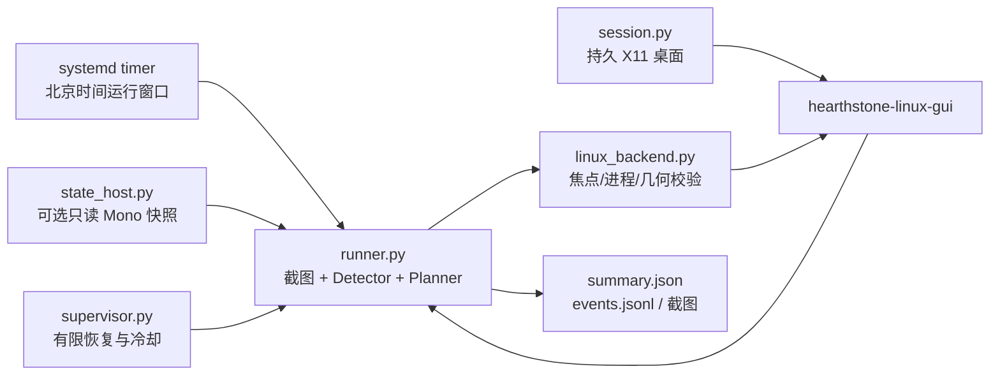

# 炉石酒馆战棋 · Linux 自动化控制器

面向 `hearthstone-linux-gui` 的 Linux 自动化控制器：通过 X11 截图、OCR 和受控鼠标输入完成酒馆战棋的基础流程，并提供可选的只读 Mono 状态观察、定时运行和有边界的故障恢复。

> **项目状态**：个人实验项目，已在 Ubuntu 24.04 x86_64、2 vCPU / 2 GiB RAM 的云主机上完成两局连续实机验证。游戏客户端、启动器或界面更新后必须重新验证；不承诺长期稳定运行，也不保证经验收益。

<p>
  
  
  
  
</p>

## 能做什么

| 能力 | 说明 |
| --- | --- |
| 识别与决策 | 识别大厅、排队、选英雄、三选一、招募、战斗、结算和断线等阶段。 |
| 基础操作 | 选英雄、进入酒馆、购买随从、上场、满场出售、处理已验证弹窗并重新排队。 |
| 安全门 | 默认只观察不点击；只有在明确传入 `--run`、窗口焦点和截图仍有效时才执行输入。 |
| 只读状态 | 可选读取当前游戏进程的 Mono 场景状态；读取失败会回退到截图识别，不写入游戏内存。 |
| 运行管理 | 支持北京时间运行窗口、`STOP` / `PAUSE` 文件、systemd 用户服务和有限次数的重启恢复。 |
| 回归测试 | 使用真实截图夹具覆盖 OCR 抖动、弹窗、断线、排程、输入互斥和状态读取边界。 |

## 工作方式



控制器以截图识别为最终操作依据。Mono 观察器只用于辅助判断场景过渡和记录诊断信息，不能绕过截图、焦点和时间新鲜度检查。

## 快速开始

### 1. 安装系统依赖

以 Ubuntu 24.04 为例：

```bash
sudo apt update
sudo apt install -y \
  python3 python3-venv \
  xvfb xauth x11-utils openbox dbus-x11
```

系统需要有可运行的 `hearthstone-linux-gui`，并先完成一次人工登录。这个仓库不包含游戏资源、账号令牌或启动器二进制。

### 2. 创建 Python 环境

项目支持 Python 3.10–3.12。仓库中的安装脚本会检查版本并安装 OCR、图像处理和 X11 依赖：

```bash
git clone https://github.com/lyy26299/battlegrounds-linux-bot.git
cd battlegrounds-linux-bot
bash setup.sh
```

如果系统同时安装了多个 Python 版本，请先让 `python3` 指向 3.10–3.12，再运行 `setup.sh`。

### 3. 配置路径

```bash
cp config.example.json config.json
$EDITOR config.json
```

至少填写启动器和游戏可执行文件路径：

```json
{
  "launcher": "/home/YOUR_USER/.local/bin/hearthstone-linux-gui",
  "game_executable": "/home/YOUR_USER/.local/share/hearthstone-linux-gui/game/Bin/Hearthstone.x86_64",
  "state_dir": "~/.local/state/battlegrounds-bot"
}
```

`config.json` 已被 `.gitignore` 排除。运行前可用只读预检确认依赖和路径：

```bash
.venv/bin/python preflight.py
```

### 4. 先观察，再运行

默认模式只截图和记录，不会点击：

```bash
.venv/bin/python runner.py --config config.json
```

确认窗口、识别和日志都正常后，才启用鼠标操作：

```bash
.venv/bin/python runner.py \
  --run \
  --auto-recover \
  --config config.json
```

常用参数：

| 参数 | 用途 |
| --- | --- |
| `--max-games 2` | 达到指定对局数后在大厅退出。 `0` 表示不按局数限制。 |
| `--max-minutes 30` | 限制单次运行时长。 `0` 表示不限制。 |
| `--daily-window` | 只在默认的北京时间 01:00–12:00 窗口内运行。 |
| `--extra-until 2026-10-27T01:00:00+08:00` | 为一次临时运行提供带时区的截止时间。 |
| `--state-host` | 读取持久状态服务的私有快照，失败时回退截图。 |
| `--state-probe` | 对当前游戏子进程进行只读 Mono 诊断。 |
| `--recovery-check` | 完成一次恢复检查后在大厅停止。 |

## 给 Agent 的部署 Prompt

如果希望让能访问目标 Linux 终端的 Agent 协助部署，可以复制下面的 Prompt。先把尖括号中的信息替换成实际值；没有 SSH 或终端权限的 Agent 只能给出命令，不能声称部署已经完成。

```text
你是我的 Linux 部署助手。请把下面这个项目部署到我授权的目标主机：

项目：https://github.com/lyy26299/battlegrounds-linux-bot
目标主机：<SSH 用户>@<主机地址>
安装目录：<例如 /home/<用户>/battlegrounds-linux-bot>
hearthstone-linux-gui 启动器：<绝对路径>
Hearthstone.x86_64：<绝对路径>
运行窗口：<例如每天 01:00–12:00，Asia/Shanghai>

请严格按以下顺序执行，并在每一步报告实际输出和结论：

1. 先检查系统：Linux、x86_64、Python 3.10–3.12、systemd user session、Xvfb、xauth、xdpyinfo、xprop、openbox、dbus-run-session、磁盘空间和可用内存。缺少条件时先说明，不要假装兼容。
2. 如果安装目录已有文件，先检查 Git 状态和现有 config.json；不要覆盖用户改动、私有配置或运行数据。全新目录才执行 clone，已有仓库只在确认后更新。
3. 按 README 安装系统依赖，使用支持版本的 Python 创建 .venv，并运行 bash setup.sh。不要使用 Python 3.13 或更高版本绕过版本检查。
4. 如果 config.json 不存在，从 config.example.json 创建；写入上面提供的启动器、游戏可执行文件和 state_dir 路径。不要索要、记录或输出账号密码、验证码、令牌、SSH 私钥、Cookie 或启动器私有日志。
5. 先人工完成官方启动器登录。遇到登录过期、验证码或二次验证时停止，把需要我手动完成的步骤告诉我。
6. 生成 systemd 用户服务但暂时不要启用每日定时：
   .venv/bin/python install_services.py --write
   systemctl --user daemon-reload
   systemctl --user start bg-desktop.service
7. 使用 DISPLAY=:91 和 XAUTHORITY=$HOME/.local/state/battlegrounds-bot/Xauthority 运行 .venv/bin/python preflight.py。预检失败就停止并报告缺项。
8. 先做只读观察，不允许点击：
   env DISPLAY=:91 XAUTHORITY=$HOME/.local/state/battlegrounds-bot/Xauthority .venv/bin/python runner.py --config config.json --max-minutes 3
   检查输出、阶段截图和最新 summary.json；确认窗口身份、分辨率、OCR 和日志路径都正常。
9. 只有在我明确确认观察结果正常并授权实际操作后，才运行一次受限的实机验证：
   env DISPLAY=:91 XAUTHORITY=$HOME/.local/state/battlegrounds-bot/Xauthority .venv/bin/python runner.py --run --auto-recover --max-games 1 --max-minutes 30 --config config.json
   如果需要我手动登录、处理弹窗或验证码，立即停止，不要自动猜测。
10. 实机验证成功后，先运行完整测试：
    .venv/bin/python -m unittest discover -s tests -v
    测试未通过时不要启用定时任务。
11. 只有在我再次确认需要长期运行时，才启用每日定时：
    .venv/bin/python install_services.py --write --enable
    systemctl --user status bg-desktop.service bg-bot.timer
    systemctl --user list-timers bg-bot.timer
12. 最后报告：实际安装目录、Python 版本、配置路径（不要输出配置内容）、预检结果、测试数量、实机验证摘要、服务状态、日志目录和停止/回滚命令。

安全要求：不要修改或替换游戏二进制，不要写入游戏内存，不要绕过认证或反作弊，不要开放公网 X11/VNC 端口，不要上传截图、config.json、launcher-private.log 或任何账号资料。遇到未知画面、游戏版本变化、权限问题、资源不足或命令会删除/覆盖数据时，先停止并向我提问。
```

## systemd 定时运行

确认人工登录、窗口尺寸和一次短时观察都正常后，可以生成用户级服务：

```bash
.venv/bin/python install_services.py --write --enable
```

查看或控制服务：

```bash
systemctl --user list-timers bg-bot.timer
journalctl --user -u bg-bot.service -f
systemctl --user stop bg-bot.service
systemctl --user disable --now bg-bot.timer
```

运行过程中创建停止标记即可让控制器收尾退出；删除标记后再按需启动：

```bash
mkdir -p ~/.local/state/battlegrounds-bot
touch ~/.local/state/battlegrounds-bot/STOP
rm ~/.local/state/battlegrounds-bot/STOP
```

`PAUSE` 会暂停识别和输入，但保留服务进程：

```bash
touch ~/.local/state/battlegrounds-bot/PAUSE
rm ~/.local/state/battlegrounds-bot/PAUSE
```

每次运行的摘要、事件和阶段截图位于 `state_dir/runs/<时间戳>/`。启动器私有日志可能包含账号信息，请勿上传或分享。

## 测试

测试不启动真实游戏，主要使用纯逻辑单元测试、X11 模拟检查和仓库内截图夹具：

```bash
.venv/bin/python -m unittest discover -s tests -v
```

测试覆盖：

- 对局计数、回大厅和未知画面保护；
- 招募阶段的购买、上场、满场出售和重复失败停止；
- OCR 抖动、黑屏、三选一和任务弹窗；
- 北京时间边界、临时截止时间和禁用排程；
- 窗口焦点、进程身份、拖拽释放和暂停互斥；
- Mono 状态读取的进程身份、范围、权限和过期快照检查。

## 目录结构

```text
runner.py                  主控制循环
core.py                    与桌面无关的阶段模型和决策器
vision.py                  截图识别与 OCR
linux_backend.py           X11 截图、窗口校验和鼠标输入
state_host.py              持久游戏进程与只读状态快照
mono_state.py              版本锁定的只读 Mono 观察器
supervisor.py              有边界的故障恢复
session.py                 持久 X11 / Xvfb 会话
install_services.py        生成 systemd 用户服务
low_spec.py                备份并调整画质、帧率和分辨率
tests/                     单元测试与真实截图夹具
experiments/               影子观察、桥接和降渲染实验
```

## 已知边界

- 仅支持 Linux x86_64 的实机运行；其他平台只能运行部分纯逻辑测试。
- 这是基础策略，不包含智能阵容、主动升本或完整英雄技能策略。
- 识别依赖当前国服界面和已验证的游戏构建；更新后可能拒绝 Mono 读取并退回截图，仍需要重新验收。
- 游戏窗口必须保持在受控 X11 桌面中并获得焦点；这不是无渲染客户端，也没有后台输入钩子。
- 2 vCPU / 2 GiB RAM 可以运行已验证场景，但资源余量很小。一次 800×600、20 FPS、20 分钟的样本中，游戏 CPU 平均约 144%（按单核计），RSS 峰值约 1360 MiB；这些数字不能推导出固定的性能收益。
- 登录过期、验证码、未知画面持续过久、启动超时或连续无效操作会停止并要求人工处理。
- 使用前请自行确认游戏客户端及相关服务条款；本项目不包含认证绕过、网络过滤或游戏内存写入。

## 只读 Mono 组件与来源

`mono_state.py` 和相关读取逻辑只打开当前用户拥有的游戏进程进行只读诊断，校验进程身份和已知程序集哈希，不修改系统 ptrace 权限、不写入游戏内存，也不读取账号凭据。相关上游来源为 [DawnMagnet/hearthstone-linux-gui](https://github.com/DawnMagnet/hearthstone-linux-gui)，许可文本见 [`LICENSE.mono-reader`](LICENSE.mono-reader)。

## 贡献与问题反馈

提交问题时请附上脱敏后的 `summary.json`、错误阶段和客户端版本；不要上传 `config.json`、`launcher-private.log`、账号信息或运行截图中的个人数据。界面更新后，优先补充截图回归测试，再调整识别或决策逻辑。
